# 🚀 AI_Flow

> **A 30-Skill, 60-Agent Autonomous Dual-Agent Ecosystem for Solo Founders, Full-Stack Engineers & Creators.**

[](https://github.com/Syed-afridi-7/AI_Flow/actions/workflows/validate-skills.yml)
[](https://agentskills.io)
[](https://deepmind.google)
[](https://claude.ai)
[](https://cursor.com)
[](https://github.com/features/copilot)
[](LICENSE)

---

## 📌 Overview

**AI_Flow** transforms solo software engineering, freelance operations, and content creation into an autonomous, startup-caliber foundry. Compliant with the [Agent Skills Open Specification](https://agentskills.io), it equips AI coding agents (**Google Antigravity**, **Claude Code**, **Cursor**, **GitHub Copilot**, **Windsurf**, and **Codex**) with **30 specialized skills** and **60 dual-agent personas** (Generator &harr; Validator peer review loops).

It runs natively as a local Windows background daemon with automatic email triage, file drop queues, and integrated social growth automation (Instagram reels and devlog repurposing).

---

## 🔄 The 8-Phase Autonomous Lifecycle (30 Skills, 60 Personas)

```mermaid
flowchart TD
    subgraph p1 ["Phase 1: Product & Architecture"]
        A["1. prd-generator"] --> B["2. trd-generator"]
        B --> C["3. app-flow"]
        C --> D["4. uiux-design-brief"]
        D --> E["5. backend-schema"]
        E --> F["6. system-architecture"]
        F --> G["7. implementation-plan"]
    end

    subgraph p2 ["Phase 2: Execution & Quality"]
        G --> H["8. task-to-skill"]
        H --> I["9. playwright-e2e-testing"]
        I --> J["10. systematic-debugging"]
    end

    subgraph p3 ["Phase 3: Auditing & Release"]
        J --> K["11. security-gap-audit"]
        K --> L["12. dead-code-cleanup"]
        L --> M["13. rigorous-code-review"]
        M --> N["14. clean-git-commits"]
    end

    subgraph p4 ["Phase 4: Design Systems & Frontend"]
        N --> O["15. design-system-tokens"]
        O --> P["16. landing-page-converter"]
        P --> Q["17. accessibility-wcag-audit"]
    end

    subgraph p5 ["Phase 5: API, Database & Performance"]
        Q --> R["18. api-contract-generator"]
        R --> S["19. db-migration-optimizer"]
        S --> T["20. performance-profiling"]
    end

    subgraph p6 ["Phase 6: DevOps, CI/CD & FinOps"]
        T --> U["21. devops-docker-deploy"]
        U --> V["22. ci-cd-pipeline-builder"]
        V --> W["23. finops-token-optimizer"]
    end

    subgraph p7 ["Phase 7: Freelance & Client Business Operations"]
        W --> X["24. freelance-client-onboarding"]
        X --> Y["25. email-inbox-triage"]
        Y --> Z["26. invoice-billing-tracker"]
    end

    subgraph p8 ["Phase 8: Social Growth & Founder OS"]
        Z --> AA["27. insta-reel-creator"]
        AA --> AB["28. seo-content-strategist"]
        AB --> AC["29. social-copy-repurposer"]
        AC --> AD["30. executive-time-ledger"]
    end
```



---

## 🧭 Multi-Agent Skills Registry (30 Skills, 60 Personas)

Every skill in [`skills/`](./skills) follows the [Agent Skills Open Specification](https://agentskills.io) and houses a **Dual-Agent Architecture** in `skills/<name>/agents/` pairing a **Generator (Persona A)** with an adversarial **Validator (Persona B)**:

| Phase & Skill | Location & Dual Personas | Triggering Conditions |
| :--- | :--- | :--- |
| **Phase 1: Product & Architecture** | | |
| **`prd-generator`** | [`skills/prd-generator/SKILL.md`](./skills/prd-generator/SKILL.md)<br>• *Gen:* Product Discovery Strategist<br>• *Val:* Scope & Feasibility Auditor | Use when initiating a new product, defining scope for a major feature, or translating an unformed idea into a structured specification. |
| **`trd-generator`** | [`skills/trd-generator/SKILL.md`](./skills/trd-generator/SKILL.md)<br>• *Gen:* Technical Systems Architect<br>• *Val:* Reliability & SLA Stress Tester | Use when translating product requirements into technical requirements, non-functional targets, p95/p99 latency budgets, and SLAs. |
| **`app-flow`** | [`skills/app-flow/SKILL.md`](./skills/app-flow/SKILL.md)<br>• *Gen:* Navigation Journey Architect<br>• *Val:* State Machine & Edge-Case Auditor | Use when mapping user navigation journeys, screen-to-screen transitions, permission gates, and edge-case state machines. |
| **`uiux-design-brief`** | [`skills/uiux-design-brief/SKILL.md`](./skills/uiux-design-brief/SKILL.md)<br>• *Gen:* Visual & Token Architect<br>• *Val:* Design System & Token Linter | Use when translating requirements into UI/UX architecture, visual tokens, screen flows, or component contracts. |
| **`backend-schema`** | [`skills/backend-schema/SKILL.md`](./skills/backend-schema/SKILL.md)<br>• *Gen:* Relational/Document Modeler<br>• *Val:* Query & Index Optimizer | Use when designing database schemas, Mermaid ERD diagrams, SQL DDL migrations, cascade rules, and composite indexes. |
| **`system-architecture`** | [`skills/system-architecture/SKILL.md`](./skills/system-architecture/SKILL.md)<br>• *Gen:* Distributed Systems Architect<br>• *Val:* Resilience & Contract Auditor | Use when architecting a software system, selecting technology stacks, designing topology, or defining API contracts. |
| **`implementation-plan`** | [`skills/implementation-plan/SKILL.md`](./skills/implementation-plan/SKILL.md)<br>• *Gen:* Engineering Roadmap Planner<br>• *Val:* Critical Path & Dependency Auditor | Use when breaking down feature specifications into phased engineering implementation plans, ordering task dependencies, and test checkpoints. |
| **Phase 2: Execution & Quality** | | |
| **`task-to-skill`** | [`skills/task-to-skill/SKILL.md`](./skills/task-to-skill/SKILL.md)<br>• *Gen:* Workflow Extraction Engineer<br>• *Val:* Spec Compliance & Rigor Verifier | Use when turning a completed engineering workflow, recurring process, or established pattern into a permanent, reusable Agent Skill. |
| **`playwright-e2e-testing`** | [`skills/playwright-e2e-testing/SKILL.md`](./skills/playwright-e2e-testing/SKILL.md)<br>• *Gen:* Browser Automation Engineer<br>• *Val:* Flakiness & Determinism Auditor | Use when setting up end-to-end testing, configuring Playwright for a web application, identifying user journeys, or writing tests. |
| **`systematic-debugging`** | [`skills/systematic-debugging/SKILL.md`](./skills/systematic-debugging/SKILL.md)<br>• *Gen:* Root-Cause Investigator<br>• *Val:* Regression Guard & Proof Verifier | Use when investigating bugs, runtime exceptions, failing automated tests, or unexpected system behavior to isolate root causes. |
| **Phase 3: Auditing & Release** | | |
| **`security-gap-audit`** | [`skills/security-gap-audit/SKILL.md`](./skills/security-gap-audit/SKILL.md)<br>• *Gen:* Vulnerability Scanner<br>• *Val:* Exploit Verifier & Threat Modeler | Use when conducting a pre-launch security review, vulnerability assessment, threat model audit, or scanning for secrets and injection risks. |
| **`dead-code-cleanup`** | [`skills/dead-code-cleanup/SKILL.md`](./skills/dead-code-cleanup/SKILL.md)<br>• *Gen:* Unused Code Pruner<br>• *Val:* Safe Dependency & Build Verifier | Use when identifying and safely removing unused files, obsolete dependencies, dead imports, or duplicate code across a codebase. |
| **`rigorous-code-review`** | [`skills/rigorous-code-review/SKILL.md`](./skills/rigorous-code-review/SKILL.md)<br>• *Gen:* Senior Staff Code Reviewer<br>• *Val:* Nitpick Filter & Actionability Auditor | Use when conducting a code review on pull requests, git diffs, or staged changes to verify correctness, detect regressions, and evaluate performance. |
| **`clean-git-commits`** | [`skills/clean-git-commits/SKILL.md`](./skills/clean-git-commits/SKILL.md)<br>• *Gen:* Conventional Commits Formatter<br>• *Val:* Git History & Diff Integrity Auditor | Use when staging changes, splitting work into atomic commits, writing Conventional Commits messages, or preparing PR histories. |
| **Phase 4: Design Systems & Frontend** | | |
| **`design-system-tokens`** | [`skills/design-system-tokens/SKILL.md`](./skills/design-system-tokens/SKILL.md)<br>• *Gen:* Token Architect<br>• *Val:* WCAG Contrast & Token Linter | Use when establishing, extracting, structuring, or maintaining multi-brand design tokens (Tailwind/CSS vars), primitives, and dark-mode themes. |
| **`landing-page-converter`** | [`skills/landing-page-converter/SKILL.md`](./skills/landing-page-converter/SKILL.md)<br>• *Gen:* Direct-Response Copywriter<br>• *Val:* Conversion UX & CTA Auditor | Use when designing, writing, or optimizing high-converting B2B SaaS landing pages, hero value props, and conversion funnels. |
| **`accessibility-wcag-audit`** | [`skills/accessibility-wcag-audit/SKILL.md`](./skills/accessibility-wcag-audit/SKILL.md)<br>• *Gen:* A11y Remediation Engineer<br>• *Val:* WCAG 2.1 AA Compliance Auditor | Use when auditing web applications or component libraries for WCAG 2.1 AA compliance, ARIA trees, keyboard traps, and contrast. |
| **Phase 5: API, Data & Performance** | | |
| **`api-contract-generator`** | [`skills/api-contract-generator/SKILL.md`](./skills/api-contract-generator/SKILL.md)<br>• *Gen:* OpenAPI 3.1 & tRPC Architect<br>• *Val:* Mock Server & Breaking-Change Verifier | Use when authoring, validating, or maintaining strict API contracts (OpenAPI 3.1, tRPC, GraphQL), mock servers, and RFC 7807 error envelopes. |
| **`db-migration-optimizer`** | [`skills/db-migration-optimizer/SKILL.md`](./skills/db-migration-optimizer/SKILL.md)<br>• *Gen:* Migration DDL Engineer<br>• *Val:* Lock Contention & Plan Auditor | Use when authoring, reviewing, or optimizing database DDL migrations for zero-downtime execution, lock avoidance, and batch backfills. |
| **`performance-profiling`** | [`skills/performance-profiling/SKILL.md`](./skills/performance-profiling/SKILL.md)<br>• *Gen:* Web Vitals & Runtime Optimizer<br>• *Val:* Memory Leak & Bundle Profiler | Use when diagnosing and resolving performance bottlenecks across frontend rendering, Core Web Vitals (LCP, CLS, INP), and memory leaks. |
| **Phase 6: DevOps, CI/CD & FinOps** | | |
| **`devops-docker-deploy`** | [`skills/devops-docker-deploy/SKILL.md`](./skills/devops-docker-deploy/SKILL.md)<br>• *Gen:* Containerization Engineer<br>• *Val:* Container Security & Cache Optimizer | Use when containerizing web applications, writing multi-stage Dockerfiles, hardening container images with non-root users, or Docker Compose. |
| **`ci-cd-pipeline-builder`** | [`skills/ci-cd-pipeline-builder/SKILL.md`](./skills/ci-cd-pipeline-builder/SKILL.md)<br>• *Gen:* GitHub Actions Architect<br>• *Val:* Pipeline Security & Concurrency Auditor | Use when authoring, auditing, or optimizing automated CI/CD workflows, GitHub Actions pipelines, security gates, and release automation. |
| **`finops-token-optimizer`** | [`skills/finops-token-optimizer/SKILL.md`](./skills/finops-token-optimizer/SKILL.md)<br>• *Gen:* Prompt Compression Engineer<br>• *Val:* LLM Cost & Cache Efficiency Auditor | Use when optimizing LLM API costs, implementing static prompt prefix caching, context pruning, model routing, or token usage limits. |
| **Phase 7: Freelance & Client Business Operations** | | |
| **`freelance-client-onboarding`** | [`skills/freelance-client-onboarding/SKILL.md`](./skills/freelance-client-onboarding/SKILL.md)<br>• *Gen:* SOW & Client Proposal Writer<br>• *Val:* Scope Creep Guard & Contract Auditor | Use when onboarding a new freelance or agency client, scoping project proposals, drafting Statements of Work (SOW), or setting billing milestones. |
| **`email-inbox-triage`** | [`skills/email-inbox-triage/SKILL.md`](./skills/email-inbox-triage/SKILL.md)<br>• *Gen:* Inbound Inquiry Classifier<br>• *Val:* Client Communications Drafter | Use when classifying inbound client emails, detecting urgent requests, extracting action items, or drafting professional replies. |
| **`invoice-billing-tracker`** | [`skills/invoice-billing-tracker/SKILL.md`](./skills/invoice-billing-tracker/SKILL.md)<br>• *Gen:* Milestone Invoice Generator<br>• *Val:* Ledger Reconciliation Auditor | Use when tracking billable freelance hours, generating milestone invoices, monitoring accounts receivable aging, or scheduling payment reminders. |
| **Phase 8: Social Growth, Content & Founder OS** | | |
| **`insta-reel-creator`** | [`skills/insta-reel-creator/SKILL.md`](./skills/insta-reel-creator/SKILL.md)<br>• *Gen:* Spoken Reel Script Architect<br>• *Val:* Hookscore & Anti-Slop Evaluator | Use when generating high-retention 30-to-60-second spoken vertical video scripts, hook banks, beat sheets, and carousel posters. |
| **`seo-content-strategist`** | [`skills/seo-content-strategist/SKILL.md`](./skills/seo-content-strategist/SKILL.md)<br>• *Gen:* Search Intent Strategist<br>• *Val:* Technical SEO & EEAT Auditor | Use when conducting search intent mapping, topic cluster (pillar-spoke) architecture, technical SEO auditing, and developer content briefs. |
| **`social-copy-repurposer`** | [`skills/social-copy-repurposer/SKILL.md`](./skills/social-copy-repurposer/SKILL.md)<br>• *Gen:* Content Repurposer<br>• *Val:* Engagement Hook & Platform Auditor | Use when transforming long-form content (blog posts, engineering devlogs, PRDs) into platform-native micro-assets for X and LinkedIn. |
| **`executive-time-ledger`** | [`skills/executive-time-ledger/SKILL.md`](./skills/executive-time-ledger/SKILL.md)<br>• *Gen:* Founder Priority Quartermaster<br>• *Val:* Daily Accountability Auditor | Use when conducting founder calendar audits, tracking high-leverage vs low-leverage activities, protecting deep work blocks, and triaging tasks. |

---

## 🛡️ Autonomous Dual-Agent Architecture

Every skill domain in `skills/` houses an `agents/` directory pairing two complementary personas:
1. **Generator (Persona A):** The architect, strategist, or builder producing the initial draft.
2. **Validator (Persona B):** The adversarial auditor evaluating the draft against an objective 100-point rubric.
3. **Self-Correcting Loop:** If score < 85, the Generator receives specific blockers and self-corrects (capped at 2 iterations to protect token budgets).

```bash
# Run any skill in autonomous dual-agent peer review mode:
python scripts/run.py --skill design-system-tokens --input "Dark mode SaaS tokens" --mode dual
```

---

## ⚡ Ways to Use AI_Flow

### 1. Autonomous Background Daemon & Email Triage (Windows)
AI_Flow runs as an autonomous background service at system login:
- Automatically triages client emails via IMAP (pure read & draft mode; never sends without approval).
- Watches `data/queue/inbox/` for dropped tasks and executes skills automatically.
- Schedules daily Instagram reel & devlog generation.

```powershell
# Manage the Windows background service
.\scripts\daemon-service.ps1 -Action Install   # Registers on-login task
.\scripts\daemon-service.ps1 -Action Status    # Inspects service & memory (<35MB)
.\scripts\daemon-service.ps1 -Action Stop      # Stops background daemon
```

---

### 2. Standalone Auto-Writer CLI
Run any skill directly from the terminal with **Gemini**, **Anthropic**, **OpenAI**, or **Grok**:

```bash
# Fast 1-turn single mode
python scripts/run.py --skill prd-generator --input "A crypto portfolio tracker"

# Autonomous 3-turn dual-agent mode with scorecard
python scripts/run.py --skill security-gap-audit --input "Audit auth middleware" --mode dual --provider anthropic

# List all 30 skills and dual-agent status
python scripts/run.py --list
```

---

### 3. Universal Multi-CLI & Agent Skills Installation
Install all skills and native plugin manifests across **Google Antigravity & Gemini IDE, OpenAI Codex, xAI Grok, OpenCode, Claude Code, Cursor AI, and Open Agents**:

```powershell
# Windows (Universal installer across all 7 CLI environments)
powershell -File scripts/install.ps1 -Target all

# Or target specific tools
powershell -File scripts/install.ps1 -Target antigravity
powershell -File scripts/install.ps1 -Target codex
powershell -File scripts/install.ps1 -Target grok
powershell -File scripts/install.ps1 -Target opencode
powershell -File scripts/install.ps1 -Target claude
powershell -File scripts/install.ps1 -Target cursor

# Verify all filesystem installations and manifest integrity
python scripts/verify_install.py
```

```bash
# macOS / Linux
chmod +x ./scripts/install.sh && ./scripts/install.sh
```

For complete CLI integration instructions, see [Multi-CLI Installation & Activation Guide](docs/MULTI_CLI_INSTALLATION_GUIDE.md).

---

### 4. 100% Offline Local LLMs with Ollama
Build the custom `ai-flow` model or run any local open-weight model:

```bash
# Build custom tuned model
ollama create ai-flow -f Modelfile

# Run skills using local Ollama
python scripts/run.py --provider ollama --skill prd-generator --input "Decentralized payment gateway"
python scripts/run.py --provider ollama --mode dual --skill security-gap-audit --input "Audit auth middleware"
```

---

## 🤖 Cross-Runtime Configuration Adapters

- **[SKILL.md](SKILL.md):** Unified master spec covering all modules for direct upload to Gemini or ChatGPT.
- **[AGENTS.md](AGENTS.md):** Universal agent instructions recognized by all modern agents.
- **[CLAUDE.md](CLAUDE.md):** Memory context and skill mappings for Claude Code.
- **[.cursor/rules/](.cursor/rules/ai-flow.mdc):** Cursor IDE workspace rules applying skills across editor sessions.
- **[.github/copilot-instructions.md](.github/copilot-instructions.md):** Repository instructions for GitHub Copilot.

---

## 📄 License

Distributed under the MIT License. See [LICENSE](LICENSE) for details.
