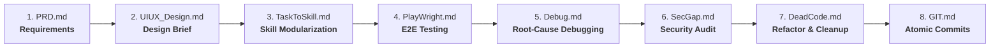

# 🚀 AI_Flow

> **A systematic, battle-tested prompt framework for end-to-end software development with AI coding assistants.**

---

## 📌 Overview

**AI_Flow** transforms chaotic prompt interactions into a disciplined, structured engineering pipeline. Whether you pair with **Antigravity**, **Cursor**, **Claude**, or **Copilot**, these templates enforce industry-standard rigor across product specification, UI/UX architecture, end-to-end testing, security audits, and clean version control.

Stop shotgun debugging and hallucinated requirements. Build production-grade software systematically.

---

## 🔄 The AI_Flow Lifecycle

---

## 📂 Framework Directory

| File | Phase | Role / Description |
| :--- | :--- | :--- |
| [**`PRD.md`**](file:///e:/Instructions/PRD.md) | **Product Definition** | Senior PM prompt to elicit constraints, user personas, MVP/v2 scope, data model sketches, and success metrics before coding. |
| [**`UIUX_Design.md`**](file:///e:/Instructions/UIUX_Design.md) | **UI/UX Architecture** | Senior Designer brief delivering design principles, tokens (colors, typography, spacing), component states, and accessibility guidelines. |
| [**`TaskToSkill.md`**](file:///e:/Instructions/TaskToSkill.md) | **Agent Memory & Skills** | Converts one-off successful engineering workflows into modular, reusable Agent Skills with triggers, instructions, and failure modes. |
| [**`PlayWright.md`**](file:///e:/Instructions/PlayWright.md) | **Quality Assurance** | End-to-end Playwright setup covering critical journeys, auth fixtures, data seeding, resilient locators, and CI integration. |
| [**`Debug.md`**](file:///e:/Instructions/Debug.md) | **Diagnostics** | 5-step disciplined debugging protocol: Restate &rarr; Hypothesize root causes &rarr; Isolate & verify &rarr; Apply minimal fix. |
| [**`SecGap.md`**](file:///e:/Instructions/SecGap.md) | **Security Audit** | Pre-launch security audit scanning for auth flaws, IDOR, injection vectors, hardcoded secrets, CORS issues, and OWASP Top 10 vulnerabilities. |
| [**`DeadCode.md`**](file:///e:/Instructions/DeadCode.md) | **Code Cleanup** | Two-phase refactor protocol (Audit &rarr; Execute) to eliminate unused routes, unreferenced imports, and duplicated logic safely. |
| [**`GIT.md`**](file:///e:/Instructions/GIT.md) | **Version Control** | Conventional Commits standard organizer enforcing atomic changes, clear intent, and reviewer-friendly commit messages. |

---

## 🛠️ How to Use

### 1. Step-by-Step Execution
Feed each template into your AI coding agent as you advance through the product development lifecycle:

1. **Ideation**: Open [`PRD.md`](PRD.md), substitute your `[DESCRIBE YOUR IDEA]` placeholder, and let the model interview you before writing specifications.
2. **Interface Planning**: Paste [`UIUX_Design.md`](UIUX_Design.md) alongside the generated PRD to establish design tokens and component contracts before touching code.
3. **Implementation**: Break down features into modular tasks. Use [`TaskToSkill.md`](TaskToSkill.md) whenever a repeatable pattern emerges.
4. **Verification**: Deploy [`PlayWright.md`](PlayWright.md) to generate robust automated end-to-end test suites.
5. **Troubleshooting**: When an error occurs, paste [`Debug.md`](Debug.md) with error logs to prevent the model from refactoring unrelated code.
6. **Hardening**: Run [`SecGap.md`](SecGap.md) and [`DeadCode.md`](DeadCode.md) prior to production deployment or merging.
7. **Release**: Organize staged and unstaged work into atomic commits using [`GIT.md`](GIT.md).

---

## 💡 Core Principles

- **No Premature Fixes:** Debugging requires isolating the root cause before writing a single line of replacement code.
- **Explicit Over Implied:** Requirements and edge cases must be clarified upfront through guided agent questions.
- **Two-Phase Modifications:** Audits (Dead Code, Security) must produce a reviewed report before any automated execution or file deletions occur.
- **Atomic History:** Commits must be self-contained, typed according to Conventional Commits, and pass builds independently.

---

## 🤝 Contributing

Contributions, additional workflow templates, and improvements are warmly welcome!

1. Fork the Project
2. Create your Feature Branch (`git checkout -b feature/NewTemplate`)
3. Commit your Changes (`git commit -m 'docs: add new API contract template'`)
4. Push to the Branch (`git push origin feature/NewTemplate`)
5. Open a Pull Request

---

## 📄 License

Distributed under the MIT License. See [LICENSE](LICENSE) for more information.
