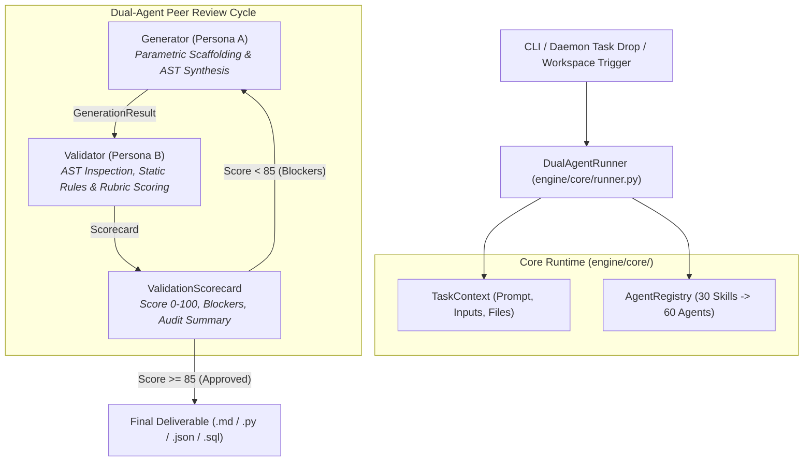

# Pure Python 60-Agent Autonomous Engine Design Specification

> **Date:** 2026-11-06  
> **Topic:** 100% Self-Contained, Zero-API, Pure Python Multi-Agent Execution Engine  
> **Target:** 30 Skills, 60 Personas (Generators & Validators) running natively without cloud API keys or external SaaS dependencies  

---

## 1. Executive Summary

This specification defines the architectural design for a **100% offline, zero-dependency, pure Python agent engine** that converts the 30 markdown-based skill specifications in `skills/` into fully functional, executable Python agent classes.

### Core Philosophy
1. **Zero External APIs & Zero Keys:** No OpenAI, Anthropic, or Gemini API keys required. All execution runs locally on the user's CPU in milliseconds.
2. **Zero Third-Party Wrappers:** No LangChain, CrewAI, AutoGen, LlamaIndex, or cloud SDKs. Built entirely on standard Python modules (`dataclasses`, `abc`, `ast`, `re`, `pathlib`, `json`, `unittest`).
3. **Deterministic Dual-Agent Peer Review:** Every skill pairs a programmatic **Generator (Persona A)** with an adversarial **Validator (Persona B)** that evaluates outputs against an objective 100-point rubric using Python AST parsing, regex pattern analyzers, and deterministic linters.
4. **Self-Correction State Machine:** If a Validator scores an artifact `< 85`, it outputs structured `Blocker` records with exact rules and line targets, triggering an automatic refinement loop.

---

## 2. System Architecture



---

## 3. Core Engine Layer (`engine/core/`)

### 3.1 Data Types (`engine/core/types.py`)

```python
from dataclasses import dataclass, field
from enum import Enum
from typing import Any, Optional

class Severity(str, Enum):
    BLOCKER = "blocker"
    WARNING = "warning"
    SUGGESTION = "suggestion"

@dataclass
class Blocker:
    rule_id: str
    message: str
    severity: Severity = Severity.BLOCKER
    line_number: Optional[int] = None
    remediation: Optional[str] = None

@dataclass
class TaskContext:
    skill_name: str
    prompt: str
    inputs: dict[str, Any] = field(default_factory=dict)
    workspace_path: Optional[str] = None
    target_files: list[str] = field(default_factory=list)

@dataclass
class GenerationResult:
    skill_name: str
    content: str
    files: dict[str, str] = field(default_factory=dict)  # filepath -> content
    metadata: dict[str, Any] = field(default_factory=dict)
    logs: list[str] = field(default_factory=list)

@dataclass
class ValidationScorecard:
    skill_name: str
    score: int  # 0 to 100
    passed: bool  # True if score >= 85
    category_scores: dict[str, int] = field(default_factory=dict)
    blockers: list[Blocker] = field(default_factory=list)
    audit_summary: str = ""
    iteration: int = 1
```

### 3.2 Base Agent Interfaces (`engine/core/base.py`)

```python
from abc import ABC, abstractmethod
from engine.core.types import TaskContext, GenerationResult, ValidationScorecard, Blocker

class BaseAgent(ABC):
    def __init__(self, name: str, skill_name: str, role: str):
        self.name = name
        self.skill_name = skill_name
        self.role = role

class BaseGenerator(BaseAgent):
    @abstractmethod
    def generate(self, context: TaskContext) -> GenerationResult:
        """Synthesize the deliverable deterministically based on context."""
        pass

    def refine(self, context: TaskContext, previous: GenerationResult, blockers: list[Blocker]) -> GenerationResult:
        """Self-correct programmatic violations identified by the Validator."""
        return self.generate(context)

class BaseValidator(BaseAgent):
    @abstractmethod
    def audit(self, result: GenerationResult, context: TaskContext) -> ValidationScorecard:
        """Run AST parsing, security scans, and rubric scoring against the deliverable."""
        pass
```

### 3.3 AST & Static Analysis Tools (`engine/core/ast_tools.py`)

A set of reusable, pure Python AST and text analysis functions used across all Validators:
* `validate_python_syntax(code: str) -> list[Blocker]`: Uses `ast.parse` to detect syntax errors.
* `scan_security_risks(code: str) -> list[Blocker]`: Scans for hardcoded secrets, unsafe `eval`/`exec`, SQL string interpolations, and unauthenticated routes.
* `check_conventional_commit(message: str) -> tuple[bool, str]`: Validates type, scope, imperative summary, and max line length.
* `calculate_contrast_ratio(hex1: str, hex2: str) -> float`: Calculates relative luminance and WCAG AA compliance (4.5:1 ratio).
* `measure_hookscore(text: str) -> int`: Evaluates spoken script hook retention (0–100) using sentence brevity, curiosity gap, and urgency metrics.

### 3.4 Dual-Agent State Machine (`engine/core/runner.py`)

```python
class DualAgentRunner:
    def __init__(self, max_refinements: int = 2):
        self.max_refinements = max_refinements

    def run_skill(self, skill_name: str, prompt: str, inputs: dict = None, mode: str = "dual") -> tuple[GenerationResult, ValidationScorecard]:
        generator, validator = AgentRegistry.get_agents(skill_name)
        context = TaskContext(skill_name=skill_name, prompt=prompt, inputs=inputs or {})
        
        # Turn 1: Generator
        result = generator.generate(context)
        
        if mode == "single":
            scorecard = ValidationScorecard(skill_name=skill_name, score=100, passed=True, audit_summary="Single mode; validator skipped.")
            return result, scorecard

        # Turn 2: Validator
        scorecard = validator.audit(result, context)
        
        # Self-Correction Loop
        iteration = 1
        while not scorecard.passed and iteration <= self.max_refinements:
            iteration += 1
            result = generator.refine(context, result, scorecard.blockers)
            scorecard = validator.audit(result, context)
            scorecard.iteration = iteration
            
        return result, scorecard
```

---

## 4. The 30 Skills & 60 Personas Implementation Map

Each skill is implemented as a standalone package under `engine/agents/<phase>/<skill_name>/` containing `generator.py` and `validator.py`:

| Phase | Skill Package | Generator Persona (Persona A) | Validator Persona (Persona B) |
| :--- | :--- | :--- | :--- |
| **Phase 1: Architecture** | `prd_generator` | ProductDiscoveryStrategist | ScopeFeasibilityAuditor |
| | `trd_generator` | TechnicalSystemsArchitect | ReliabilitySlaStressTester |
| | `app_flow` | NavigationJourneyArchitect | StateMachineEdgeCaseAuditor |
| | `uiux_design_brief` | VisualTokenArchitect | DesignSystemTokenLinter |
| | `backend_schema` | RelationalModeler | QueryIndexOptimizer |
| | `system_architecture` | DistributedSystemsArchitect | ResilienceContractAuditor |
| | `implementation_plan` | RoadmapPlanner | CriticalPathAuditor |
| **Phase 2: Execution** | `task_to_skill` | WorkflowExtractor | SpecComplianceVerifier |
| | `playwright_e2e_testing`| BrowserAutomationEngineer | FlakinessDeterminismAuditor |
| | `systematic_debugging` | RootCauseInvestigator | RegressionProofVerifier |
| **Phase 3: Release** | `security_gap_audit` | VulnerabilityScanner | ThreatModelAuditor |
| | `dead_code_cleanup` | UnusedCodePruner | SafeDependencyVerifier |
| | `rigorous_code_review` | SeniorStaffCodeReviewer | NitpickFilterAuditor |
| | `clean_git_commits` | ConventionalCommitFormatter | DiffIntegrityAuditor |
| **Phase 4: Design** | `design_system_tokens` | TokenArchitect | WcagContrastLinter |
| | `landing_page_converter`| DirectResponseCopywriter | ConversionUxAuditor |
| | `accessibility_wcag_audit`| A11yRemediationEngineer | WcagComplianceAuditor |
| **Phase 5: API & Data** | `api_contract_generator`| ApiContractArchitect | BreakingChangeVerifier |
| | `db_migration_optimizer`| MigrationDdlEngineer | LockContentionAuditor |
| | `performance_profiling` | WebVitalsOptimizer | MemoryLeakProfiler |
| **Phase 6: DevOps** | `devops_docker_deploy` | ContainerizationEngineer | DockerSecurityAuditor |
| | `ci_cd_pipeline_builder` | ActionsArchitect | PipelineSecurityAuditor |
| | `finops_token_optimizer`| PromptCompressor | TokenCacheAuditor |
| **Phase 7: Freelance Ops**| `freelance_client_onboarding`| SowProposalWriter | ContractScopeAuditor |
| | `email_inbox_triage` | InboundInquiryClassifier | ClientCommunicationsDrafter |
| | `invoice_billing_tracker`| MilestoneInvoiceGenerator | LedgerReconciliationAuditor |
| **Phase 8: Growth** | `insta_reel_creator` | SpokenReelScriptArchitect | HookscoreAntiSlopAuditor |
| | `seo_content_strategist`| SearchIntentStrategist | TechnicalSeoAuditor |
| | `social_copy_repurposer`| ContentRepurposer | PlatformHookAuditor |
| | `executive_time_ledger` | PriorityQuartermaster | AccountabilityAuditor |

---

## 5. CLI & Daemon Integration

### 5.1 CLI Runner (`engine/cli.py`)
Provides an interactive command-line experience:
```bash
python -m engine.cli --skill backend-schema --input "E-commerce order processing schema" --mode dual
```
Supports:
* `--skill <name>`: Target skill name.
* `--input "<text>"`: User prompt or file path.
* `--mode {single,dual}`: Single generation or dual peer-review.
* `--output <dir>`: Directory to write generated artifacts.
* `--list`: Prints all 30 skills and their registered Python personas.

### 5.2 Background Daemon (`scripts/daemon.py`)
Updates the daemon task execution cycle to support `mode: "local"`:
* When a task file is placed in `data/queue/inbox/*.json`, the daemon passes it directly to `DualAgentRunner` in memory.
* Zero HTTP requests, zero API key checks, zero internet needed.

---

## 6. Testing & Quality Assurance Plan

### 6.1 Automated Test Suite (`tests/test_engine.py`)
* **Registry Integrity:** Verifies that all 30 skills are discovered, loadable, and instantiate both a Generator and Validator.
* **Rubric Determinism:** Verifies that every Validator produces scores strictly between 0 and 100 with required category breakdowns.
* **Refinement Convergence:** Verifies that passing a known deficient input results in the Generator's `.refine()` addressing blockers and improving the score.
* **Zero Dependency Check:** Verifies that no external packages (such as `openai`, `anthropic`, `google-generativeai`, `requests`) are imported by the core engine.
* **Speed Target:** The entire 60-agent test suite executes in under 5 seconds.

---

## 7. Delivery Milestones

1. **Phase 1: Core Engine Framework**
   - Create `engine/core/` (`types.py`, `base.py`, `ast_tools.py`, `registry.py`, `runner.py`).
2. **Phase 2: Implement Phase 1–4 Skills (14 Skills, 28 Agents)**
   - Architecture, Execution, Auditing, and Design Systems.
3. **Phase 3: Implement Phase 5–8 Skills (16 Skills, 32 Agents)**
   - API/Data, DevOps, Freelance Operations, and Growth/Founder OS.
4. **Phase 4: CLI, Daemon Integration & Test Suite**
   - Implement `engine/cli.py`, connect `scripts/daemon.py`, author `tests/test_engine.py`.
5. **Phase 5: Full Verification & GitHub Sync**
   - Run tests, verify zero-dependency execution, commit and push to `main`.
