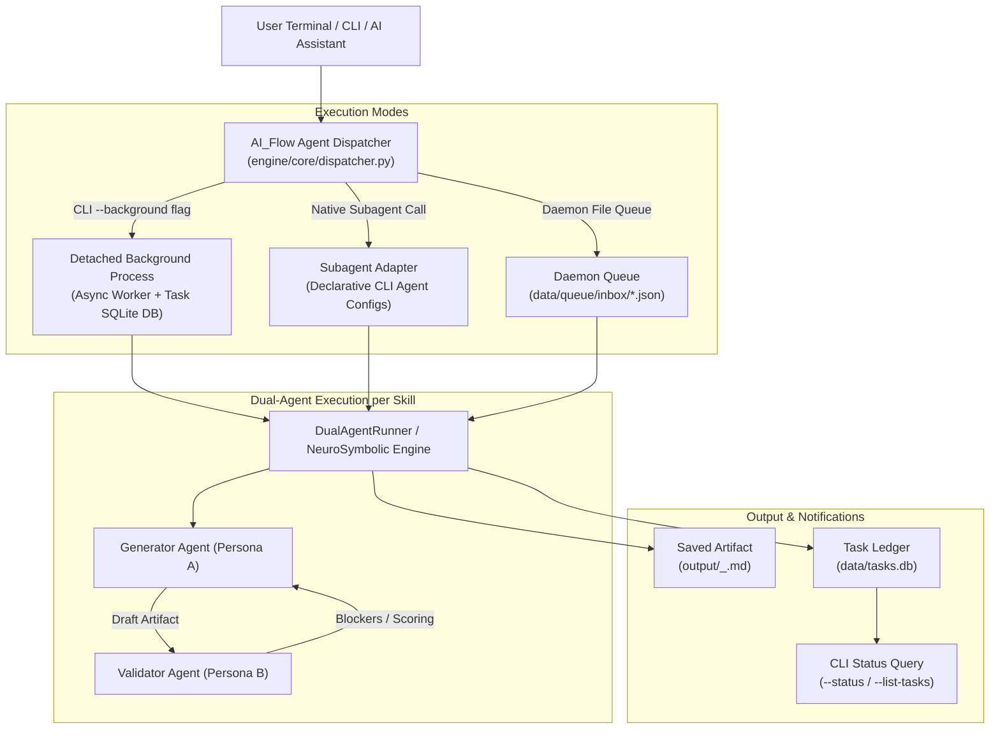

# Background Agent Dispatcher & Asynchronous Task System Architecture

**Document ID:** `2026-11-07-background-agent-dispatcher-design`  
**Author:** AI_Flow Architectural Engineering  
**Status:** Approved by User  
**Target Date:** 2026-11-07  

---

## 1. Executive Summary

AI_Flow currently possesses 30 production-grade skills and 60 dual-agent persona classes (Generators and Validators) across 8 lifecycle phases. While these agents can execute synchronously in the foreground via `engine.cli` (pure Python offline engine) and `scripts/run.py` (Ollama/Gemini/OpenAI/Claude runner), users and host AI CLI tools (such as Google Antigravity, OpenAI Codex CLI, xAI Grok CLI, OpenCode, and Anthropic Claude Code) need the ability to dispatch any skill to execute autonomously in the **background** without freezing or blocking the terminal or active conversation.

This specification defines the **Universal Background Agent Dispatcher** (`engine/core/dispatcher.py`), extending `engine.cli` and `scripts/run.py` with asynchronous process detachment (`--background`), an ACID SQLite task ledger (`data/tasks.db`), real-time status and log inspection (`--status`, `--list-tasks`, `--logs`), process lifecycle controls (`--cancel`), and subagent integration hooks.

---

## 2. Core Architectural Principles

1. **Zero External Dependencies:**
   All components are implemented strictly using the Python 3.10+ standard library (`sqlite3`, `subprocess`, `os`, `signal`, `json`, `pathlib`, `time`, `datetime`, `logging`). No external pip dependencies are required.
2. **Instant CLI Detachment (< 50ms):**
   When invoked with `--background`, the dispatcher records the task, spawns a detached background worker process, and immediately returns control to the user's terminal with the unique Task ID and OS PID.
3. **Cross-Platform Process Decoupling:**
   - **Windows:** Spawns via `subprocess.DETACHED_PROCESS | subprocess.CREATE_NEW_PROCESS_GROUP`, `close_fds=True`, and redirected stdio handles.
   - **Unix/macOS:** Spawns via `start_new_session=True` (`setsid`).
4. **Resilient Task State Machine:**
   Every task transitions deterministically through well-defined states: `queued` &rarr; `running` &rarr; `completed` / `failed` / `cancelled`.
5. **Dual-Agent Integrity Guarantee:**
   Background tasks execute the full Generator &rarr; Validator &rarr; Neuro-Symbolic AST Repair feedback loop, saving both the verified artifact and audit scorecard.

---

## 3. System Architecture & Component Design



### 3.1. SQLite Task Ledger (`data/tasks.db`)

The ledger is managed by `TaskManager` in `engine/core/dispatcher.py`:

```sql
CREATE TABLE IF NOT EXISTS agent_tasks (
    task_id TEXT PRIMARY KEY,
    skill_name TEXT NOT NULL,
    mode TEXT DEFAULT 'dual',
    provider TEXT DEFAULT 'local',
    status TEXT NOT NULL,          -- 'queued', 'running', 'completed', 'failed', 'cancelled'
    pid INTEGER,
    input_preview TEXT,
    started_at TEXT NOT NULL,
    completed_at TEXT,
    exit_code INTEGER,
    score INTEGER,
    verdict TEXT,
    output_file TEXT,
    log_file TEXT,
    error_message TEXT
);

CREATE INDEX IF NOT EXISTS idx_tasks_status ON agent_tasks(status);
CREATE INDEX IF NOT EXISTS idx_tasks_skill ON agent_tasks(skill_name);
```

### 3.2. Background Worker Protocol

A standalone worker entrypoint (`engine/core/worker.py` or `python -m engine.core.worker --task-id <id>`) handles execution:
1. Reads task configuration from `data/tasks.db`.
2. Updates `status = 'running'`, `pid = os.getpid()`.
3. Invokes `DualAgentRunner().run_skill(skill_name, prompt, mode)`.
4. Writes final Markdown artifact to `output/{skill_name}_{task_id}.md`.
5. Updates `data/tasks.db` with `status = 'completed'`, `score`, `verdict`, and `completed_at`.
6. Traps uncaught exceptions, writing full traceback to `data/logs/{task_id}.log` and updating `status = 'failed'`, `error_message = str(e)`.

---

## 4. CLI Interface & Command Specification

Both `engine.cli` and `scripts/run.py` are extended with these options:

### 4.1. Dispatch Background Task
```bash
python -m engine.cli --skill prd-generator --input "Decentralized social network" --background
```
**Console Output:**
```text
======================================================================
  AI_FLOW AUTONOMOUS ENGINE (Background Dispatch)
======================================================================
  • Skill:       prd-generator
  • Mode:        DUAL
  • Task ID:     task_20261107_7a9f1b2c
  • Worker PID:  15892
  • Log File:    data/logs/task_20261107_7a9f1b2c.log
  • Status:      RUNNING (in background)
======================================================================
🚀 Task successfully dispatched to background!
   Check status:  python -m engine.cli --status task_20261107_7a9f1b2c
   View logs:     python -m engine.cli --logs task_20261107_7a9f1b2c --tail 20
```

### 4.2. Query Tasks & Status
```bash
# List all tasks
python -m engine.cli --list-tasks

# Query specific task status
python -m engine.cli --status task_20261107_7a9f1b2c

# View live worker logs
python -m engine.cli --logs task_20261107_7a9f1b2c --tail 30

# Cancel a running task
python -m engine.cli --cancel task_20261107_7a9f1b2c
```

---

## 5. Error Handling, Timeouts & Dead Process Recovery

1. **Dead PID Reconciliation:**
   When `--status <id>` or `--list-tasks` is invoked, if a task is marked `running` but the OS confirms the PID is no longer alive (`os.kill(pid, 0)` raises `OSError`), the dispatcher automatically reconciles the task state to `failed` with `error_message = "Process terminated unexpectedly"`.
2. **Execution Timeouts:**
   Configurable timeout (default: 300 seconds). If the worker exceeds the timeout, the process records timeout details and exits gracefully.
3. **Safe Signal Termination:**
   `--cancel <task_id>` sends `signal.SIGTERM` (or `TerminateProcess` on Windows) to terminate the worker cleanly, updating `status = 'cancelled'`.

---

## 6. Verification & Test Plan

1. **Unit Test Suite (`tests/test_dispatcher.py`):**
   - SQLite table creation, indexing, task insertions, and status updates.
   - Unique Task ID generation format (`task_YYYYMMDD_...`).
   - Mocked subprocess spawning across platforms (`creationflags` on NT, `start_new_session` on POSIX).
   - Dead PID detection and reconciliation logic.
   - Cancel task and log retrieval tests.
2. **End-to-End Live Execution Test:**
   - Dispatch live skill in background: `python -m engine.cli --skill prd-generator --input "Test task" --background`.
   - Ensure the dispatch command exits in < 100ms.
   - Wait for status to reach `completed`.
   - Verify output artifact exists in `output/` with score &ge; 85.
   - Verify log file exists in `data/logs/`.
3. **Multi-CLI Compatibility:**
   - Verify `--background` works seamlessly with `scripts/run.py --provider ollama`.
   - Verify all existing 99 unit tests pass without regressions.
