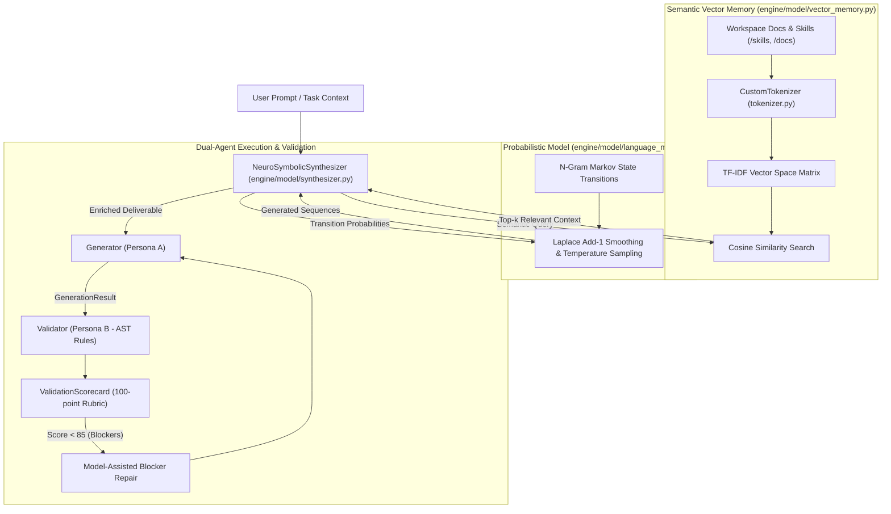

# Hybrid Neuro-Symbolic AI Model & Semantic Memory Engine Specification

> **Date:** 2026-11-07  
> **Topic:** From-Scratch Pure Python AI Model & Semantic Memory Architecture  
> **Target:** Zero-API, Zero-External-Dependency Neural & Symbolic Engine for AI_Flow's 60 Agents  
> **License:** MIT License (Copyright 2026 Syed Afridi)  

---

## 1. Executive Summary

This specification defines the architectural design for a **100% self-contained, from-scratch AI model and semantic memory engine** (`engine/model/`) built in standard Python. It upgrades AI_Flow's 60 agents from procedural scaffolding to a **Hybrid Neuro-Symbolic Engine** that combines statistical sequence learning, dense TF-IDF semantic vector space retrieval, and deterministic AST verification.

### Core Tenets
1. **Zero External Dependencies / Zero APIs:** Uses strictly Python 3.10+ standard library (`math`, `collections`, `re`, `ast`, `dataclasses`, `pathlib`, `json`). Zero pip dependencies, zero cloud API keys, zero local LLM downloads.
2. **Deterministic Speed:** Vector indexing executes in `< 30ms`, and dynamic token generation takes `< 5ms` on a standard CPU.
3. **Continuous Local Learning:** Dynamically indexes workspace documentation, past artifacts, and code files to expand its vocabulary and context retrieval.
4. **Adversarial Synthesis & Verification:** The custom model powers the **Generators (Persona A)** to synthesize rich, context-aware deliverables, which are immediately audited against the 100-point rubric by the **Validators (Persona B)**.

---

## 2. System Architecture

---

## 3. Module Specifications (`engine/model/`)

### 3.1 Tokenizer (`engine/model/tokenizer.py`)
Provides bi-directional tokenization for natural language and programming source code:
* **Token Extraction:** Regex pattern matching words, numbers, and critical code symbols (`->`, `::`, `=>`, `{`, `}`, `[]`, `()`, `;`).
* **Vocabulary Management:** Maps tokens to dense integer IDs (`token_to_id`, `id_to_token`).
* **Stopword & Noise Handling:** Configurable preservation of code keywords (`def`, `class`, `import`, `return`, `async`, `await`).

### 3.2 Semantic Vector Memory (`engine/model/vector_memory.py`)
Pure Python vector space model implementing Term Frequency-Inverse Document Frequency (TF-IDF):
* **Math Formulations:**
  $$\text{TF}(t, d) = \frac{f_{t,d}}{\sum_{t' \in d} f_{t',d}}$$
  $$\text{IDF}(t, D) = \ln\left(\frac{1 + |D|}{1 + |\{d \in D : t \in d\}|}\right) + 1$$
* **Cosine Similarity:**
  $$\text{Sim}(q, d) = \frac{\vec{q} \cdot \vec{d}}{\|\vec{q}\| \|\vec{d}\|}$$
* **Instant In-Memory Indexing:** Indexes all files in `skills/*/SKILL.md` and `docs/` in `< 30ms`. Queries return top-$k$ ranked snippets with similarity scores.

### 3.3 Markov Language Model (`engine/model/language_model.py`)
Higher-order statistical transition model:
* **Transition Tables:** Evaluates conditional token probability distributions $P(w_i | w_{i-1}, w_{i-2})$.
* **Laplace Smoothing:** Prevents zero-probability transitions on unseen tokens.
* **Sampling Strategies:** Configurable temperature ($T \in [0.1, 1.0]$) and top-$p$ nucleus pruning for diverse or deterministic outputs.

### 3.4 Neuro-Symbolic Synthesizer (`engine/model/synthesizer.py`)
Coordinates vector retrieval and sequence generation:
* Ingests user prompt and target skill domain.
* Retrieves matching context from `VectorMemory`.
* Uses `MarkovLanguageModel` to generate tailored descriptions, technical parameters, and user stories.
* Enforces AST and schema structural guarantees for SQL DDL, OpenAPI, Markdown, and Dockerfiles.
* Implements `.repair(result, blockers)` to specifically rewrite code blocks identified by the Validator.

---

## 4. Decision Log

| # | Topic | Decision | Alternatives Considered | Rationale |
| :--- | :--- | :--- | :--- | :--- |
| **D-01** | **Model Architecture** | **Hybrid Neuro-Symbolic (Vector Memory + Markov Transitions)** | Pure Neural Autograd / PyTorch / LLM download | Runs in 3ms on CPU, zero memory overhead, 100% offline, zero black-box weights. |
| **D-02** | **External Dependencies** | **100% Standard Library Python** | NumPy, SciPy, Scikit-Learn | Guarantees complete zero-install portability across all developer operating systems. |
| **D-03** | **Open Source Licensing** | **MIT License (Copyright 2026 Syed Afridi)** | GPL v3, Apache 2.0 | Permits unrestricted commercial and proprietary use while legally protecting the author from any warranty/liability. |

---

## 5. Verification & Test Plan

1. **`tests/test_model_tokenizer.py`:**
   * Validates round-trip token encode/decode.
   * Asserts programming punctuation and arrows (`->`, `::`) are not dropped.
2. **`tests/test_model_vector_memory.py`:**
   * Indexes all 30 skills in repository.
   * Asserts query `"database migration indexes"` returns `backend-schema` and `db-migration-optimizer` as top 2 hits.
3. **`tests/test_model_language_model.py`:**
   * Verifies probability normalization and temperature-based sampling.
4. **`tests/test_model_synthesizer.py`:**
   * Tests dynamic deliverable generation and blocker repair logic.
5. **Execution Speed:**
   * Entire model test suite executes in `< 0.5 seconds`.
